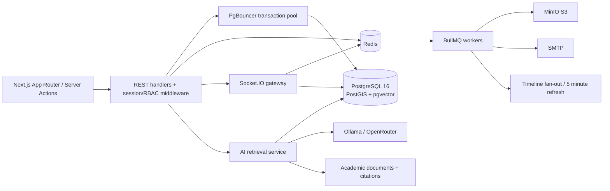

# MUT Social backend architecture

## Request and worker boundaries

- API instances remain stateless. Sessions are random opaque HTTP-only cookie tokens stored as hashes in `mut_sa_sessions`; Redis stores short-lived OTP and rate-limit state. Use a shared Redis-backed limiter across instances.
- PgBouncer runs in transaction mode. Application connections disable prepared statements, and each API process has a small pool. Provision and load-test the pool against the database rather than treating the Compose defaults as capacity guarantees.
- Feed reads use `(created_at, id)` cursors. Follow timelines are hydrated asynchronously; trending scores are computed from recent engagement velocity. BullMQ handles fan-out and periodic refreshes.
- Socket.IO uses Redis adapter for cross-instance delivery. Persist ciphertext messages before acknowledgement; the queue is only an offline delivery buffer. Client-side keys are required for end-to-end encryption.
- Media uploads go to private MinIO buckets through short-lived presigned URLs. Workers transcode videos to HLS, publish manifests, and delete eligible originals after the configured retention window.
- RAG retrieval filters by school/course where available, returns document title/source references with answers, and falls back to a “not found in the supplied sources” response when context is insufficient.

## Delivery state

The PostgreSQL migration and idempotent initial community seed are in `apps/web/drizzle/postgres`. `apps/web/src/db/postgres/schema.ts` is the Drizzle model for the primary production tables. The existing app still imports its SQLite database and Better Auth setup; changeover requires a data migration and migration of every existing route before PostgreSQL can be the app's active database. This scaffold does not claim that the current application already meets the 5,000-user or 200 ms targets; those require deployment-specific load tests, metrics, and capacity tuning.

The supplied degree and school labels come from the request brief, not a verified current MUT catalogue. Confirm names, fee documents, and official media before treating the seed or RAG corpus as authoritative. Community content does not fabricate fee amounts or calendar dates.
